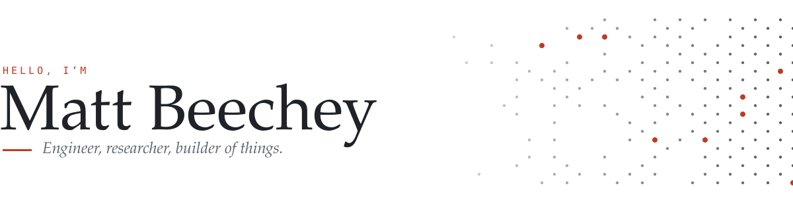

<picture>
  <source media="(prefers-color-scheme: dark)" srcset="https://raw.githubusercontent.com/Beechey/.github/main/profile/assets/header-dark.svg">
  
</picture>

  
  
  
  

I like building things end to end, from AI agents and Android apps down to circuit boards and firmware. By day I'm an AI engineer at [TransHumanity](https://transhumanity.ai). Here's what I've been making lately.

## Building

<table>
<tr>
<td width="50%" valign="top">

**[Seam](https://github.com/aveterosystems/seam)** · open source 
Links an Android phone to a Mac: notifications, texts, clipboard and files. End-to-end encrypted with Signal's libsignal, with a single Rust core shared by SwiftUI and Jetpack Compose apps. 
`Rust` `libsignal` `Swift` `Kotlin` `Cloudflare Workers`

</td>
<td width="50%" valign="top">

**[outpost](https://github.com/Beechey/outpost)** 
One command turns a bare Ubuntu server into an always-on home for AI coding agents. A second moves everything, including unfinished agent threads, to a new server. 
`Go` `Tailscale` `Docker` `Claude Code` `T3 Code`

</td>
</tr>
<tr>
<td width="50%" valign="top">

**[Relay](https://github.com/Beechey/relay-releases)** 
A remote-first IPTV player for Android TV, Fire TV and phones. Streams huge catalogues and XMLTV guides to disk as they download, so big playlists never run out of memory. 
`Kotlin` `Jetpack Compose` `Media3` `Android TV`

</td>
<td width="50%" valign="top">

**[Traffic Insight](https://github.com/Beechey/traffic_insight)** 
Aerial computer vision that tracks how vehicles actually use a junction. YOLO11 fine-tuned for small, dense, arbitrarily rotated vehicles seen from above. 
`PyTorch` `YOLO11` `OpenCV`

</td>
</tr>
</table>

## Toolkit

<table>
<tr><td><b>ML & agents</b></td><td>PyTorch · LangGraph · PydanticAI · scikit-learn · GNNs · computer vision · evals</td></tr>
<tr><td><b>Software</b></td><td>Python · TypeScript · Go · Rust · Kotlin · C · SQL</td></tr>
<tr><td><b>Data & cloud</b></td><td>PostgreSQL · DuckDB · Iceberg · Redis · Docker · AWS</td></tr>
<tr><td><b>Hardware</b></td><td>STM32 firmware · PCB design (KiCad, Altium) · MQTT over LTE-M · GNSS</td></tr>
</table>

## Papers

PhD in machine learning for network security, Loughborough University.

- [Evidential classification for defending against adversarial attacks on network traffic](https://doi.org/10.1016/j.inffus.2022.11.024) · *Information Fusion*, 2023
- [Evidential classification and feature selection for cyber-threat hunting](https://doi.org/10.1016/j.knosys.2021.107120) · *Knowledge-Based Systems*, 2021

---

<i>Up for conversations about trustworthy AI, agent tooling, or anything with a sensor on it. The best ones happen over good coffee. ☕</i>

